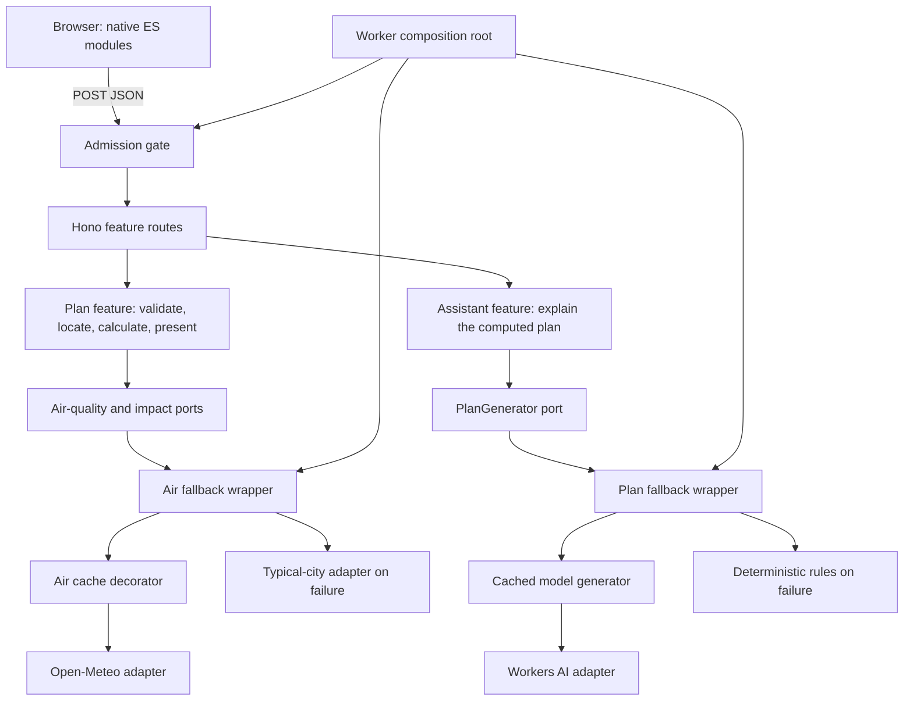

# Code Quality

How the code is organised, the quality rules it is held to, and the tests and
commands that verify those rules. Architectural descriptions document the
current implementation.

## SOLID, with the files that apply each principle

| Principle                 | How it is applied                                                                                                                                                                                                                                                                           | Files                                                                                                                                                                                                                                                                                                                                                                                                                        |
| ------------------------- | ------------------------------------------------------------------------------------------------------------------------------------------------------------------------------------------------------------------------------------------------------------------------------------------- | ---------------------------------------------------------------------------------------------------------------------------------------------------------------------------------------------------------------------------------------------------------------------------------------------------------------------------------------------------------------------------------------------------------------------------- |
| **Single responsibility** | Every module has one job, named in its opening comment. A strategy, a factor family, a screening rule, an adapter and a decorator each get their own file                                                                                                                                   | [strategies/](src/features/plan/strategies/), [impact/factors/](src/features/impact/factors/), [prompt-guard/rules/](src/lib/prompt-guard/rules/), [providers/](src/features/air-quality/providers/), [generators/](src/features/assistant/generators/)                                                                                                                                                                      |
| **Open/closed**           | New behaviour is added by adding a file and one list entry; the code that runs the list does not change. The planner test proves it by running a strategy the registry has never heard of                                                                                                   | [strategies/registry.ts](src/features/plan/strategies/registry.ts) and [planner.ts](src/features/plan/planner.ts); [rules/index.ts](src/lib/prompt-guard/rules/index.ts) and [scan.ts](src/lib/prompt-guard/scan.ts); [factors/index.ts](src/features/impact/factors/index.ts); the rule list in [app.ts](src/app.ts) and [admission.ts](src/middleware/admission.ts); [planner.test.ts](test/features/plan/planner.test.ts) |
| **Liskov substitution**   | Live, cached, fallback and offline providers all honour `AirQualityProvider`; model, cached, fallback and rule-based generators all honour `PlanGenerator`. One contract test runs over every implementation, and the test doubles are plain objects typed by the same ports, with no casts | [providers/substitutable.test.ts](test/features/air-quality/providers/substitutable.test.ts), [generators/substitutable.test.ts](test/features/assistant/generators/substitutable.test.ts), [test/support/fakes.ts](test/support/fakes.ts)                                                                                                                                                                                   |
| **Interface segregation** | Ports are the narrowest shape their caller uses: `Clock` has one method, `Cache` two, `Geocoder` one. Routes receive only the sources and gate they need, never the whole dependency set, and the Worker's bindings are declared as three narrow interfaces rather than the generated `Env` | [lib/ports.ts](src/lib/ports.ts), [air-quality/types.ts](src/features/air-quality/types.ts), [assistant/types.ts](src/features/assistant/types.ts), [plan/routes.ts](src/features/plan/routes.ts), `Bindings` in [index.ts](src/index.ts)                                                                                                                                                                                    |
| **Dependency inversion**  | Features depend on ports, and adapters implement them. A single composition root chooses the adapters and stacks the decorators. A test asserts that `caches`, `console`, `Date` and the bindings are each named in exactly one module                                                      | [index.ts](src/index.ts), [lib/cache.ts](src/lib/cache.ts), [lib/clock.ts](src/lib/clock.ts), [lib/logger.ts](src/lib/logger.ts), [assistant/workers-ai.ts](src/features/assistant/workers-ai.ts), [layers.dom.test.ts](test/conventions/layers.dom.test.ts)                                                                                                                                                                 |

## Layers

A module may import its own unit or a lower layer, never sideways or upwards.

| Height | Unit                                              | May import                               |
| ------ | ------------------------------------------------- | ---------------------------------------- |
| 0      | `src/config`                                      | nothing in `src`                         |
| 1      | `src/lib`                                         | config                                   |
| 2      | `src/middleware`                                  | lib, config                              |
| 3      | `src/features/air-quality`, `src/features/impact` | middleware, lib, config (not each other) |
| 4      | `src/features/plan`                               | air-quality, impact and below            |
| 5      | `src/features/assistant`                          | plan and below                           |
| 6      | `src/app.ts`                                      | features and below                       |
| 7      | `src/index.ts`                                    | everything                               |

[layers.dom.test.ts](test/conventions/layers.dom.test.ts) parses every import in
`src/` and fails on a violation.

## Runtime architecture and design patterns

The Worker is composed once from narrow ports and concrete adapters. Feature
code receives its dependencies; only the composition root knows about Cloudflare
bindings, the platform cache, `fetch` and the console logger.

| Pattern or mechanism    | Concrete use                                                                                                                       | Why it is used                                                                                                 |
| ----------------------- | ---------------------------------------------------------------------------------------------------------------------------------- | -------------------------------------------------------------------------------------------------------------- |
| Ports and adapters      | Feature interfaces in `features/*/types.ts`; adapters in `providers/`, `generators/` and `workers-ai.ts`; wiring in `src/index.ts` | Domain logic can run against test doubles without depending on Cloudflare or external services.                |
| Decorator               | `cachedAir`, `cachedGeocoder`, `cachedPlanGenerator` and their fallback wrappers                                                   | Cache and resilience behaviour are layered around the same port contract.                                      |
| Strategy and registry   | The eleven strategies in `features/plan/strategies/`, assembled in `STRATEGIES`                                                    | Recommendation algorithms stay independently testable and can be registered without changing the planner loop. |
| Chain of responsibility | `admissionGate` runs the ordered `AdmissionRule` list and stops at the first refusal                                               | Request checks remain independently composable and short-circuit before route work.                            |
| Schema validation       | Zod schemas validate incoming profiles, cached air/place values and cached narratives                                              | Values crossing runtime boundaries are checked rather than trusted because of TypeScript types.                |
| Deterministic fallback  | Live air data falls back to typical-city data; assistant generation falls back to rule-based wording                               | The app can still provide a plan when an external provider or model is unavailable.                            |
| Number firewall         | `number-firewall.ts` and `reply-issues.ts` compare generated numerals with facts already computed by the impact engine             | Model-written explanations cannot introduce unsupported numeric claims.                                        |

### Why some modules are deliberately small

Small files are a consequence of the project's responsibility boundaries, not a
target to maximise file count. A strategy, screening rule, factor family or
provider adapter has an independent name, dependency surface and test seam. The
repository's convention test enforces the 3.5 KB source-module limit and the
layer test prevents imports from crossing feature boundaries. A short module is
worth keeping when it isolates one independently understandable behaviour; it
should be combined with another module when the boundary adds navigation cost
without a meaningful dependency or testing benefit. File length by itself is not
treated as a measure of maintainability.

## Frontend response contracts

The page receives JSON, which is untrusted at runtime even though the Worker
itself is written in TypeScript. `public/js/guards.js` validates every field the
renderers read from `/api/plan` and `/api/assistant`, including recommendation
impacts, factors, hourly readings, findings and every narrative explanation. The
category check reuses the generated `CATEGORIES` list from
`src/config/options.ts`, so the browser does not maintain a second category
allow-list. Guard regression tests live in `test/public/guards-*.dom.test.ts`.

The entry script is a native `type="module"` script in the document head.
Browsers defer module execution until the document has been parsed, so querying
the form at module evaluation time is safe for this page; an extra
`DOMContentLoaded` wrapper would add lifecycle code without fixing a current
race. Frontend JavaScript remains JavaScript, checked with JSDoc by
`tsconfig.app.json`; using one language for browser code is not itself a runtime
or type-safety defect.

## Metrics and claims

The repository publishes only metrics that its checks can reproduce: lint
limits, TypeScript/JSDoc checks, and the coverage thresholds below. It does not
currently calculate a repository-wide duplication percentage, average cyclomatic
complexity or Maintainability Index, so no values for those metrics are claimed
here. Add such a metric only with a named tool, a reproducible command and
output from this exact revision.

## Limits enforced by lint

From [eslint.config.js](eslint.config.js), applied to source, front end, tests
and scripts alike, with zero warnings allowed:

| Rule                                       | Limit                                                 |
| ------------------------------------------ | ----------------------------------------------------- |
| `max-lines`                                | 110 lines per file, blank lines and comments excluded |
| `max-lines-per-function`                   | 30 lines                                              |
| `complexity`                               | cyclomatic complexity 8                               |
| `max-depth`                                | 3                                                     |
| `max-params`                               | 3                                                     |
| `consistent-type-assertions`               | no `as` casts (only `as const`)                       |
| `no-explicit-any`, `no-non-null-assertion` | forbidden                                             |
| `noInlineConfig`                           | no `eslint-disable` comments anywhere                 |
| `no-console`                               | forbidden outside [lib/logger.ts](src/lib/logger.ts)  |
| `no-warning-comments`                      | no TODO, FIXME, XXX or HACK                           |

TypeScript runs in strict mode with `noUncheckedIndexedAccess`, `noUnusedLocals`
and `noUnusedParameters` ([tsconfig.json](tsconfig.json)). The typescript-eslint
strict type-checked rule set is on for every file.

## Conventions enforced by tests

[files.dom.test.ts](test/conventions/files.dom.test.ts) reads the repository and
fails unless:

- every TypeScript file and front-end module opens with a comment saying what
  its one job is;
- every export of the Worker, the front end and the test support modules has a
  doc comment;
- every source module is under 3.5 KB, every test file under 4 KB and every
  stylesheet under 4 KB (the largest source module today is 3.1 KB, the median
  1.3 KB).

Vitest enforces a minimum of 100% statement, branch, function and line coverage
for `src/**/*.ts` and `public/js/**/*.js`; generated shared copies are excluded
([vitest.config.ts](vitest.config.ts)). This is a configured gate, not a claim
that a particular run passed; the current run's coverage report is the evidence.

## One source of truth

The form's options, labels, ranges and messages are defined once in
[src/config/](src/config/) and compiled for the page by
[scripts/build-assets.mjs](scripts/build-assets.mjs), so the page and the Worker
cannot disagree. The security headers for static assets are generated from
[security-policy.ts](src/config/security-policy.ts), the same data the Worker
applies. [form-setup.dom.test.ts](test/public/form-setup.dom.test.ts) and
[security-policy.test.ts](test/config/security-policy.test.ts) check both.

## Frontend modules

The eleven native ES modules in [public/js/](public/js/) each have one browser
responsibility, follow the same lint limits and are type-checked through JSDoc
([tsconfig.app.json](tsconfig.app.json)). The response-contract section above
describes their runtime boundary.
